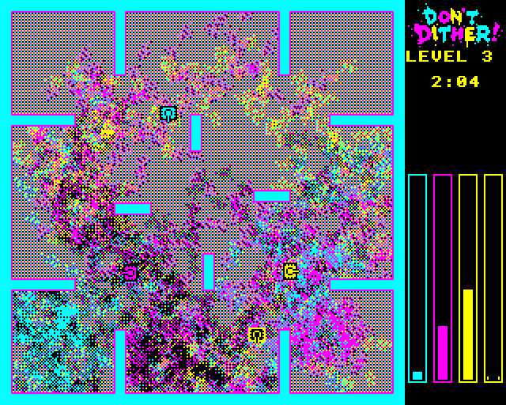
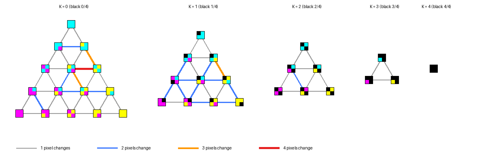
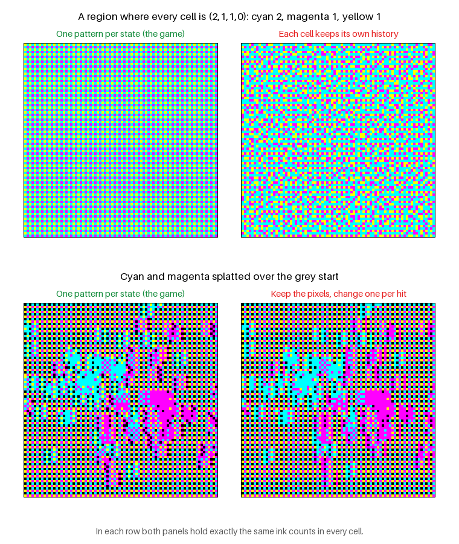
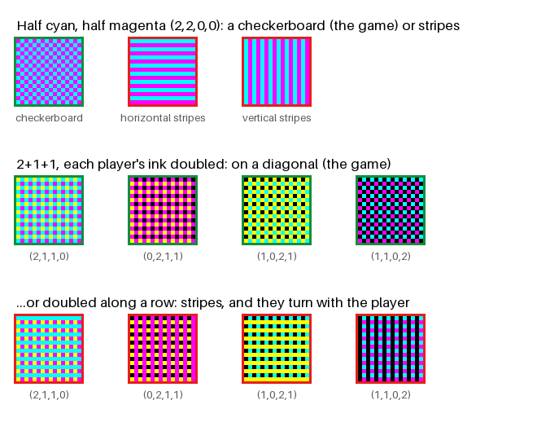
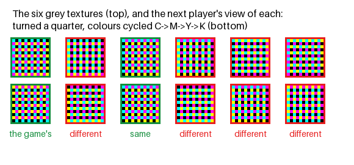
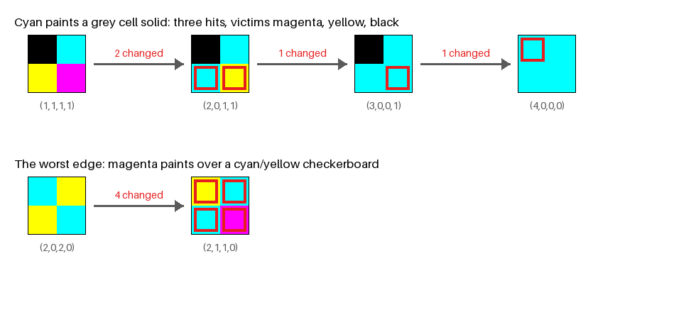
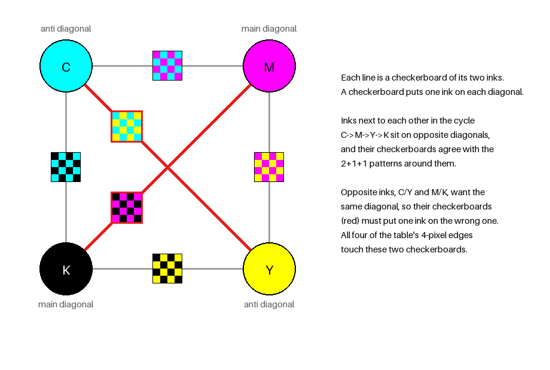
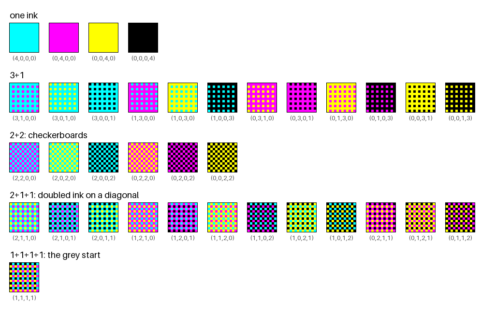

# Choosing 35 dither patterns for *Don't Dither!*

*Don't Dither!* is a territory game for the BBC Micro: two or four tanks
spray cyan, magenta, yellow and black ink across an arena, and whoever
owns the most of it when the clock runs out wins. Its central trick is
that **the screen is the game state**. There is no ownership map in
memory; the dither patterns you see *are* the score. This article is about
how we chose those patterns: what we wanted from them, what got in the
way, and how a constraint solver settled it.

## The screen is the state

The game runs in MODE 1: 320×256 pixels, four colours, set by the palette
to cyan, magenta, yellow and black (CMYK). The arena is the left 256×256
pixels, divided into 128×128 *superpixels* of 2×2 pixels each.

A superpixel is the game's unit of territory. Think of it as holding four
**quanta** of ink, one per pixel, so its ownership is a count tuple
(C, M, Y, K) adding up to 4. (3,1,0,0) is three quarters cyan and one
quarter magenta; (1,1,1,1) is the grey that every four-player arena
starts as, an equal share for everyone.

- **There are 35 such states** (the ways to split 4 among 4 inks).
- **There are 256 possible patterns** of four pixels in four colours.

So we need a rule for drawing each state. We chose **exactly one pattern
per state**, its *canonical pattern*: 35 of the 256. Reading a cell is
then a table lookup, and writing one is drawing its state's pattern.

## Painting moves one quantum

A hit doesn't add ink, because a cell always holds exactly four quanta. It
**moves one quantum**: the painter's count goes up by one and another
ink's, the victim's, goes down by one. (Which victim is chosen is a
fairness question of its own, answered by a round-robin rule; it doesn't
affect the patterns.)

Draw the 35 states as nodes and join any two that one hit can connect,
and you get a graph with **120 edges**. Every hit on every cell, all game
long, walks one of them. Geometrically it's a tetrahedron: the pure inks
at the corners, the grey at the centre.

The patterns we pick decide what each of those 120 steps looks like on
screen. We wanted three things from them.

## What we wanted

### 1. Spatial coherence: ownership you can read

A region where every cell has the same ownership should look the same
everywhere: one even texture, so the eye reads ownership directly.

That's why one pattern per state, rather than letting each cell keep
whatever pixels painting gave it. The alternative is tempting: a hit
could always recolour just one pixel, the victim's, which is the smallest
possible change. But then a cell's look depends on its history, not its
ownership:

*Top: every cell holds (2,1,1,0). Drawn canonically it's a uniform
texture; with each cell keeping its own history it's noise. Bottom: a
field painted by cyan and magenta, the same states in both panels. The
history-dependent version has streaks and speckle that mean nothing.*

The decision was made on looks, not cost: the 6502 could read any of the
256 patterns as a state just as cheaply.

Coherence also says something about *which* pattern each state gets:

- **Checkerboards for 50:50 mixtures.** A 2+2 state such as (2,2,0,0) can
  be a checkerboard or stripes. Stripes read as lines, and as different
  lines horizontally and vertically.
- **For 2+1+1 states, the doubled ink on a diagonal.** Tiled across a
  region, the doubled ink then forms a checkerboard rather than stripes.

*The bottom row is what we'd get with the doubled ink along a row: each
player's mixture becomes stripes, and, because of the fairness rule
below, cyan's run one way and magenta's the other.*

### 2. Fairness: every player's ink looks alike

*Don't Dither!* is a game of small advantages, so fairness is designed in
by symmetry. A four-player arena is symmetric under a quarter turn, and a
quarter turn takes each player's start to the next player's. So the
whole game, turned 90° with its colours relabelled C→M→Y→K→C, should be
the same game.

We wanted the *pictures* to respect that too: no player's ink should get
stripier or noisier textures than another's. The rule is:

> Relabelling a pattern's colours one step round the cycle must give the
> same pattern as turning the tile 90° clockwise.

Exactly that is impossible alongside checkerboards. Cycling twice swaps C
with Y and leaves the state (2,0,2,0) unchanged; two quarter turns make a
half turn, which leaves a checkerboard unchanged. So the cyan/yellow
checkerboard would have to equal itself with its colours swapped, and it
can't.

So we allow **a one-pixel shift**. Across a region of repeated tiles, the
texture shifted by a pixel *is* the same texture; only where it meets a
different texture can you tell.

The grey start shows what the rule is protecting. A 2×2 tile of four
different colours has 24 arrangements, which fall into six distinct
textures. For only two of them is the next player's view of the arena,
turned a quarter and recoloured, the same texture:

*With any of the four red textures, the starting grey would look
different from different seats.*

### 3. Low churn: a hit changes few pixels

The **churn** of an edge is how many pixels differ between its two
states' patterns, from 1 to 4. A hit moves one quantum, so ideally it
changes one pixel, and the texture evolves smoothly as a region is
painted.

But each state's one pattern has to serve all of its neighbours at once:
3 for a solid ink, up to 12 for the grey. So some edges must cost more,
and the job is to keep those few and small.

*Cyan paints a grey cell solid in three hits. The first moves a quantum
from magenta, but changes two pixels: to keep the two cyans on a
diagonal, the new cyan takes yellow's place, and yellow moves into
magenta's. Below, the worst kind of edge: all four pixels change.*

## The surprise: the choice is only about phase

We set this up as a search: for each of the 35 states, pick one
arrangement, subject to the rules. But once the two texture rules
(checkerboards and diagonals) are in place, something useful falls out.

**Every state except the grey has exactly one texture, up to a
one-pixel shift.**

- A 3+1 state's minority pixel can be in any corner, and the four corners
  are shifts of each other.
- A checkerboard has two arrangements, shifts of each other.
- A 2+1+1 state with its doubled ink on a diagonal has four arrangements,
  all shifts of each other.

| State type | States | Arrangements allowed | Distinct textures |
|---|---|---|---|
| one ink | 4 | 1 | 1 |
| 3+1 | 12 | 4 | 1 |
| 2+2 | 6 | 2 (checkerboards) | 1 |
| 2+1+1 | 12 | 4 (diagonals) | 1 |
| 1+1+1+1 | 1 | 24 | 6, of which the fairness rule allows 2 |

Two things follow.

- **Fairness comes almost free.** Because every texture is the same up to
  a shift, the fairness rule only constrains the grey. It cuts the grey's
  24 arrangements to 8.
- **The two-player game is fair too, without another rule.** A
  two-player arena's symmetry is a half turn that swaps C with M and Y
  with K. A half turn of a 2×2 tile is itself a one-pixel shift (diagonally),
  so it changes nothing that matters; we checked that the table respects
  it.

So what's left to choose isn't what each state looks like. It's each
state's **phase**: which of its equivalent shifts sits in the screen's
fixed 2×2 grid. Phase is invisible within a region, but it decides how
many pixels change when a cell moves to a neighbouring state. **Churn is
a phase-alignment problem.**

## Solving it

The search space is still big: 4²⁴ phases for the 3+1 and 2+1+1 states,
2⁶ for the checkerboards and 8 grey arrangements, about 10¹⁷ tables.
We gave it to Google's OR-tools CP-SAT solver:

- **Variables:** a boolean for each candidate arrangement of each state,
  exactly one chosen per state.
- **Constraints:** the three rules above.
- **Objective:** for each of the 120 edges, an indicator of its churn,
  with 4-pixel edges weighted 1,000, 3-pixel edges 10 and 2-pixel edges
  1.

The solver finds the best table and **proves it optimal**. Here's what
each rule costs, from runs with fewer rules:

| Rules | Edges changing 1 pixel | 2 | 3 | 4 |
|---|---|---|---|---|
| none: pure minimum churn | 84 | 36 | 0 | 0 |
| checkerboards and fairness, not diagonals | 78 | 36 | 6 | 0 |
| **all three: the game's table** | **78** | **32** | **6** | **4** |

Without any rules, no edge needs more than 2 pixels. The texture rules
bring in ten edges of 3 or 4 pixels.

## Why some edges must be bad

The four 4-pixel edges all touch the same two states: the cyan/yellow
checkerboard (2,0,2,0) and the magenta/black one (0,2,0,2). That's no
coincidence.

A checkerboard puts one ink on the main diagonal (top-left to bottom-right)
and the other on the anti-diagonal. A 2+1+1 state puts its doubled ink on
a diagonal too. For a checkerboard and its 2+1+1 neighbours to differ by
one pixel, the shared ink needs to sit on the *same* diagonal in both.

So ideally each ink would have a diagonal of its own. But a checkerboard
needs its two inks on *opposite* diagonals, and there are checkerboards
for all six pairs of inks. Four inks can't be split into two sides so
that every pair is on opposite sides: any split leaves some pairs on the
same side. The best split leaves two, and the game's table uses the
symmetric one: cyan and yellow on the anti-diagonal, magenta and black on
the main.

All 12 of the table's 2+1+1 patterns follow that split. The two
checkerboards whose inks share a side, C/Y and M/K, the pairs opposite
each other in the colour cycle, can't follow it. One of their inks has
to sit on the "wrong" diagonal, and the expensive edges cluster around
them. (This explains where the cost falls; the solver's proof is what
shows four is the least possible.)

## Why we accepted the cost

Churn costs the 6502 nothing. Painting a cell rewrites both of its
half-bytes, whatever changed. The only cost of a 4-pixel edge is that a
cell's texture jumps rather than steps when it's hit, and in a splat of
16 cells that land at once, that's hard to see.

Coherent, fair textures, on the other hand, are on screen every frame. So
we took the 78/32/6/4 table over the smoother 84/36/0/0 one.

## The table

## On the machine

In MODE 1 a byte holds four pixels, so a superpixel is half of one byte
in each of two consecutive raster lines (the top and bottom rows of its
2×2 tile).

- **Reading a cell** takes the cell's two pixels from each of those bytes
  and packs them into one byte: `(top AND &CC) OR ((bottom AND &CC) >> 2)`
  for a cell in the left half of the byte, and
  `((top AND &33) << 2) OR (bottom AND &33)` for the right. That indexes a
  256-byte, page-aligned table, `pattern_to_state`, which gives the state
  (or "not an ink" for the 221 patterns the game never draws).
- **Writing a cell** takes the state's top and bottom bytes from two
  35-entry tables and masks them into the screen.

The patterns live in one place, `data/ink_patterns.json`, written by the
solver. The game's tables are generated from it, and the test suite
checks every property in this article: the texture rules, the fairness
rule, the 78/32/6/4 histogram, and that the 6502's index formula agrees
with the model for all 256 patterns.

## Try it yourself

The source is at <https://github.com/rob-smallshire/dont-dither>:

- `tools/dontdither/solve_patterns.py`: the solver
  (`uv run --group solver dd-solve-patterns`);
- `tools/dontdither/inks.py`: the model of states, patterns and their
  symmetries;
- `tools/dontdither/preview_dither_figures.py`: this article's figures
  (`uv run dd-preview-dither-figures`);
- `docs/ink_patterns.md`: the same ground in reference form.
