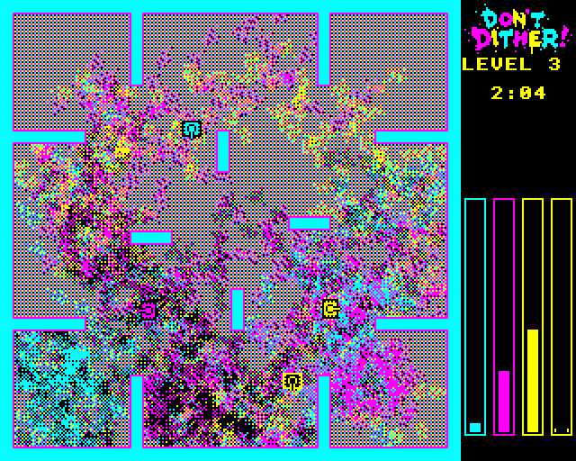

# Don't Dither!

A four-colour territory game for the BBC Micro, written in 6502 assembly.

Two or four tanks spray cyan, magenta, yellow and black ink across an
arena, and whoever owns the most of it when the clock runs out wins. The
twist: there is no ownership map in memory. Each 2×2 cell's dither
pattern *is* its ownership, one of the 35 mixtures of the four inks, so
the screen is the game state.

## Play it

- **Download** a disc image from the
  [latest release](https://github.com/rob-smallshire/dont-dither/releases/latest):
  the `.ssd` for DFS on a Model B, or the `.adl` for ADFS on a Master
  Compact.
- **Boot** it with Shift-Break, on the real thing or in an emulator.
- **Up to four players** share one keyboard, or use joysticks on a Master
  Compact with SPItFIRE.

## Articles

- [Choosing 35 dither patterns](../articles/choosing_the_dither_patterns.md):
  the constraints (spatial coherence, fairness, low churn), the analysis
  and the constraint solver behind the game's dither patterns.

## Source

The source, the design notes and the test suite are on GitHub:
[rob-smallshire/dont-dither](https://github.com/rob-smallshire/dont-dither).
